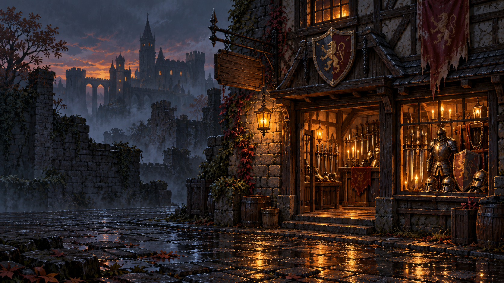

# Dungeon Merchant

A dark fantasy shopkeeping RPG built with Python and a local browser interface. Bargain with adventurers, manage stock, commission expeditions, build your character and confront the enemy who ruined your house.



**[Download for Windows](https://github.com/bytbyt006-source/dungeon-merchant/releases/latest/download/DungeonMerchant-Windows-x64.zip)** · **[Beginner guide](docs/QUICKSTART.md)** · **[Latest release](https://github.com/bytbyt006-source/dungeon-merchant/releases/latest)**

## Play on Windows

1. Download `DungeonMerchant-Windows-x64.zip` from Releases.
2. Extract the ZIP completely, then double-click `DungeonMerchant.exe`.
3. The game opens in your default browser. No Python installation is required.
4. Keep the launcher window open while playing. Close it to stop the local server.

The game runs locally at `127.0.0.1`; it does not need an online account. Packaged saves are stored in `%LOCALAPPDATA%\DungeonMerchant\save.json`. Progress saves automatically after successful actions; **Save** also writes the current progress. **Continue** resumes it. **New game** archives the previous campaign before starting again.

Version 1.0.1 includes ambient and battle music, separate music/effects volume controls, and original synthesized sound effects. Music is included for this noncommercial educational game under the permissions described in CREDITS.md. The previous v1.0.0 release remains available.

## Your first day

You begin with **1,000 gold**, **20,000 gold of debt**, an empty warehouse, four shelves and five attribute points to distribute.

- On Monday, click the merchant wagon and buy a small selection of goods. Purchases enter your warehouse.
- Open **Warehouse**, select a shelf and an item, choose **Bargain** or **Marked price**, set quantity and price, then select **Place / replace**.
- Admit a customer. Customers enter for compatible items currently stocked on your shelves.
- Inspect their equipment, manner and purse. Drag the price marker and roll the D20, or accept the offer.
- Confirm the sale, then click the money pouch to collect your payment. See the customer out to finish the visit.

Marked prices are capped at 15% above acquisition cost. Bargain shelf prices are capped at 50%; negotiation can go higher, with lower success chances. Keep operating cash: rent is **200 gold per week**, and scheduled debt repayment is **1,000 gold per month**. Every day has up to ten customers. Read the [beginner guide](docs/QUICKSTART.md) for equipment, potions, combat and commissions.

## What you can do

- Trade weapons, armour, accessories and healing potions; restock or replace displays from storage.
- Meet randomized customers and returning identities, with profession-compatible artwork, five moods and personal journals.
- Negotiate using D20 checks, observations, character attributes and talents.
- Wear common, magic, rare and legendary equipment with affixes and attribute requirements.
- Buy or steal carried equipment, face personality-dependent reactions, and fight wanted criminals for loot.
- Fight with independent attack timers, dodging, blocking, hit effects and consumable healing.
- Drink Life Potions for up to 40 HP. Drinking during combat restarts the drinker's attack timer; the opponent continues attacking.
- Commission adventurers to explore three regions, lend a weapon and armour, collect loot and unlock deeper routes.
- Repay the debt early or through monthly payments, then defeat the family nemesis to finish the campaign.

Running out of cash and recoverable goods can end a viable business. There is no bailout system; return to the menu and start a new campaign. Counterfeit goods, reputation, shop expansion and autonomous adventures after ordinary purchases are outside this release.

## Run the source

Python **3.10 or later** and a modern browser are required. The game uses Python's standard library; no runtime pip packages are needed.

```sh
python main.py
```

On Windows, `Start Game.bat` runs the same command. Keep the project files together. Opening `index.html` directly does not start the Python rules engine.

Optional server arguments:

```sh
python main.py --no-browser --port 8765
python main.py --save path/to/another-save.json
```

Source runs save to `saves/save.json`. The server binds only to localhost, validates action requests and does not serve Python files or saves over HTTP.

## Source layout

| File | Responsibility |
| --- | --- |
| `main.py` | Local HTTP server, launcher and request validation |
| `game.py` | Campaign state, shop transactions, calendar, debt and atomic JSON persistence |
| `pricing.py` | Price limits and negotiation difficulty |
| `equipment.py` | Equipment, affixes, identification, loadouts and attributes |
| `combat.py` | Theft reactions, mercy, timed attacks and defeat |
| `commissions.py`, `dungeon_loot.py` | Expedition planning, resolution and regional loot |
| `skills.py`, `final_boss.py` | Talents, experience, wanted rewards and campaign ending |
| `index.html`, `game.css`, JavaScript files | Presentation, controls, animation and audio |
| `tests/` | Rule, migration and browser-control regression tests |

Python owns the rules, money and inventory. JavaScript displays server results and animates them. English docstrings and comments explain state transitions and non-obvious calculations.

## Validate and build

```sh
python -m unittest discover -s tests -q
node tests/controls_transition_test.cjs
node tests/audio_options_test.cjs
node tests/battle_feedback_test.cjs
```

The JavaScript checks are optional developer checks and require Node.js. See [BUILD.md](docs/BUILD.md) for Windows packaging. File input/output, exception handling and automated testing are used throughout the Python implementation.

## Credits and asset use

Artwork was generated with OpenAI image generation. Source development used AI assistance. Image-generation prompts are retained with the assets. Sound effects in the public edition are synthesized from code. Ambient and battle music are credited separately and retain their original rights. See [CREDITS.md](CREDITS.md).

No open-source licence is granted by this repository. Public visibility permits viewing and downloading; it does not itself grant permission to redistribute the project or its assets.
